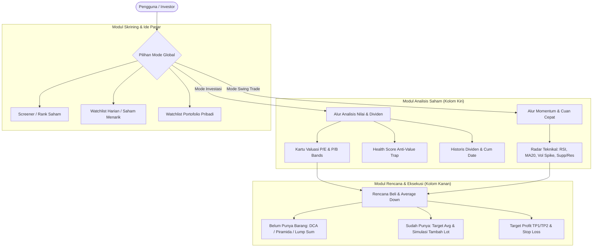

# Functional Specification Document (FSD)
## IDX Valuation & Execution Dashboard (idx-valuation-web)

**Versi:** 1.0.0  
**Tanggal:** 22 Oktober 2026  
**Status:** Approved / Production-Ready  
**Domain:** Bursa Efek Indonesia (IDX / BEI)

---

### 1. Pendahuluan & Ringkasan Eksekutif
Aplikasi **IDX Valuation & Execution Dashboard** adalah platform analitik cerdas yang dirancang untuk membantu investor dan trader saham di Bursa Efek Indonesia (IDX). Aplikasi ini menjembatani dua kebutuhan utama pelaku pasar saham:
1. **Long-Term Investing (🌿):** Menilai valuasi saham secara objektif menggunakan Mean Historical Standard Deviation (P/E & P/B 5 tahun), pembagian dividen (Yield on Cum Date & Annual Rate), deteksi Anti-Value Trap (kesehatan finansial), serta strategi eksekusi beli berbasis Dollar-Cost Averaging (DCA) atau Piramida Beli.
2. **Swing Trading & Momentum (⚡):** Mendeteksi peluang cuan cepat dalam rentang hari hingga minggu berbasis RSI(14), Moving Average (MA20/MA50), lonjakan volume (*Volume Spike*), titik pantulan *Support/Resistance*, serta kalkulasi dinamis rasio risiko terhadap keuntungan (*Risk-to-Reward Ratio*).

---

### 2. Persona Pengguna
* **Value Investor:** Mencari saham salah harga (*undervalued*) dengan *Margin of Safety* (MoS) tinggi dan rasio profitabilitas sehat (ROE > 10%, DER aman).
* **Dividend Hunter:** Menghitung proyeksi pendapatan pasif (*passive income*) dari dividen kas tahunan, melacak riwayat dividen saat *Cum Date*, dan menghitung modal yang dibutuhkan untuk mencapai target dividen bulanan/tahunan.
* **Swing Trader:** Mencari saham dengan likuiditas tinggi yang sedang mengalami *Volume Breakout*, *Oversold Rebound*, atau *Momentum Rally*, serta membutuhkan rencana keluar (*Exit Plan*) ketat (TP1, TP2, dan SL terukur).
* **Retail "Nyangkut" Trader:** Pelaku pasar yang sedang mengalami *floating loss* dan membutuhkan simulasi rasional untuk *Average Down* (menghitung jumlah lot dan dana yang dibutuhkan agar harga rata-rata turun ke target tertentu).

---

### 3. Arsitektur Modul Fungsional

---

### 4. Spesifikasi Fungsional Terinci

#### 4.1. Global Mode Switcher
* **Deskripsi:** Pengendali mode sentral yang terletak di header aplikasi dan panel samping kanan.
* **Perilaku Sistem:**
  * **Mode Investasi (🌿):** Menyelaraskan seluruh tab dan ranking untuk fokus pada nilai fundamental, Margin of Safety, dividen tunai, dan horizon investasi jangka panjang.
  * **Mode Swing Trade (⚡):** Menyelaraskan seluruh tab dan ranking untuk memprioritaskan indikator momentum, volume breakout, pantulan oversold, dan target resisten jangka pendek.

---

#### 4.2. Modul Analisis Valuasi Fundamental (5-Year Historical Bands)
* **P/E & P/B Historical Banding:**
  * Mengambil data historis bulanan selama 5 tahun terakhir.
  * Menghitung nilai mean historis, standard deviation (-1 SD, Mean, +1 SD).
  * Menghitung **Harga Wajar Konservatif**: Rata-rata harga wajar berbasis P/E dan P/B:
    $$\text{Fair Price} = \frac{(\text{EPS} \times \text{PER Mean}) + (\text{BVPS} \times \text{PBV Mean})}{2}$$
  * Menghitung **Margin of Safety (MoS)**:
    $$\text{MoS (\%)} = \frac{\text{Fair Price} - \text{Harga Saat Ini}}{\text{Fair Price}} \times 100$$
  * Menentukan status harga saham:
    * `Murah (Undervalued)`: MoS $\ge +15\%$
    * `Wajar (Fair Price)`: $-15\% < \text{MoS} < +15\%$
    * `Mahal (Overvalued)`: MoS $\le -15\%$

---

#### 4.3. Modul Anti-Value Trap (Financial Health Multi-Factor)
* **Tujuan:** Mencegah investor membeli saham yang tampak murah secara P/E tetapi fundamental perusahaannya sedang memburuk.
* **Komponen Evaluasi:**
  * **Return on Equity (ROE):** Tolok ukur kemampuan mencetak laba bersih dari modal ($\ge 10\%$ = Sehat).
  * **Debt to Equity Ratio (DER):** Tolok ukur beban utang ($\le 1.2\times$ = Sehat; dikecualikan untuk sektor perbankan/finansial).
  * **Net Profit Margin (NPM):** Efisiensi marjin laba bersih ($\ge 8\%$ = Sehat).
  * **Revenue & Earnings Growth:** Pertumbuhan pendapatan dan laba bersih tahunan.
* **Scoring & Status:**
  * `🟢 Sangat Sehat (Solid)`: Lolos minimal 3 dari 4 kriteria utama.
  * `🟡 Cukup / Waspada`: Lolos 2 kriteria; terdapat pelemahan pada salah satu metrik.
  * `🔴 Hati-Hati / Value Trap Risk`: Margin laba tergerus atau utang tinggi.

---

#### 4.4. Modul Radar Teknikal & Momentum Swing Trade
* **Relative Strength Index (RSI 14 Daily):**
  * $\text{RSI} \le 35$: Sinyal `🟢 Oversold (Pantulan Rebound)`.
  * $35 < \text{RSI} < 70$: Sinyal Netral / Momentum Lanjutan.
  * $\text{RSI} \ge 70$: Sinyal `⚠️ Overbought (Rawan Koreksi)`.
* **Moving Averages (MA20 & MA50):**
  * Mengukur status tren harga: *Uptrend* (harga > MA20), *Downtrend* (harga < MA20), atau *Golden Cross Potential*.
* **Volume Spike Detector:**
  * Rasio volume perdagangan hari ini terhadap rata-rata volume 20 hari:
    $$\text{Volume Spike} = \frac{\text{Volume Hari Ini}}{\text{Volume Rata-rata 20 Hari}}$$
  * Rasio $\ge 1.5\times$ mengindikasikan lonjakan akumulasi institusi/bandar (`🚀 Volume Breakout`).
* **Support & Resistance Terdekat:**
  * Support: Titik terendah 20 hari (*20-Day Low*).
  * Resistance: Titik tertinggi 20 hari (*20-Day High*).

---

#### 4.5. Modul Perencanaan Beli & Risk Management (Panel Kanan - Tab Rencana)

##### Skenario A: Belum Punya Barang (Fresh Entry)
* **Kalkulator Pembagian Lot:**
  * **Piramida Beli (Aggressive on Weakness):** Membagi modal ke 3 tahap (40% di harga saat ini, 30% saat koreksi -4%, 30% saat koreksi -8%).
  * **DCA (Dollar-Cost Averaging):** Membagi modal rata ke dalam 3 periode tanpa memusingkan volatilitas harian. Default aktif pada saham bervaluasi wajar.
  * **Lump Sum (All-In):** Membeli seluruh lot di harga pasar hari ini. Sistem menampilkan peringatan jika valuasi tidak sedang diskon.
* **Rencana Jual & Stop Loss (Exit Plan):**
  * **Mode Investasi:**
    * TP1: Target Harga Wajar Konservatif (Jual 50% muatan).
    * TP2: Valuasi +1 SD Euforia Pasar (Jual 50% sisa).
    * SL: Batas risiko penurunan fundamental (-8%).
  * **Mode Swing Trade:**
    * TP1: Area Resistance 20 Hari (Jual 50% muatan).
    * TP2: Momentum Rally Breakout (+10%).
    * SL: Batas Cut Loss ketat di bawah garis Support (-4% s/d -5%).
    * **Risk-to-Reward Ratio:** Menghitung rasio potensi keuntungan dibanding risiko secara otomatis (misal `1 : 2.5`).

##### Skenario B: Sudah Punya Barang (Average Down & Rescue Nyangkut)
* **Mode Target Avg:** Pengguna menentukan harga rata-rata yang diinginkan; sistem menghitung lot tambahan dan modal yang dibutuhkan secara eksak:
  $$\text{Lot Tambahan} = \left\lceil \frac{L_0 \times (P_0 - \text{Target})}{\text{Target} - P_{\text{pasar}}} \right\rceil$$
* **Mode Simulasi Beli Lot:** Pengguna memasukkan jumlah lot yang ingin dibeli; sistem menghitung harga rata-rata baru yang akan terbentuk beserta persentase penurunannya.
* **Rencana Exit Posisi Nyangkut:** Menghitung proyeksi nominal keuntungan/kerugian (dalam Rupiah) dari harga modal rata-rata pengguna saat ini jika menyentuh TP1, TP2, atau SL.

---

#### 4.6. Modul Skrining Saham & Filter Harga (Tab Rank Diskon / Rank Swing)
* **Kategori Tampilan:**
  * **Mode Investasi:** "Rank Saham Undervalued" (diurutkan berdasarkan MoS tertinggi).
  * **Mode Swing Trade:** "Rank Saham Potensi Cuan Cepat" (diurutkan berdasarkan skor gabungan Ruang Cuan Resistance + Volume Spike + RSI Oversold).
* **Filter Minimal Market Cap:**
  * Mencegah saham gorengan/lapapis tiga; pilihan cepat: > 0.5T, > 1T, > 5T, > 10T, > 50T.
* **Filter Rentang Harga Saham (Per Lembar):**
  * `Semua`: Menampilkan seluruh spektrum harga saham.
  * `1 - 100`: Khusus saham lapis bawah/gocap (Rp 1 s/d Rp 100).
  * `100 - 1k`: Khusus saham lapis menengah (Rp 101 s/d Rp 1.000).
  * `> 1k`: Khusus saham berharga di atas Rp 1.000.

---

#### 4.7. Modul Watchlist Harian (Pilihan Saham Menarik Hari Ini)
* **Kategori Mode Investasi:**
  1. *Diskon Jumbo (Super Undervalued)*: Saham MoS $\ge 20\%$.
  2. *Dividen Jumbo*: Dividend Yield $\ge 6\%$ per tahun.
  3. *Rebound Hijau Hari Ini*: Penguatan harga $\ge 1.5\%$ dengan valuasi murah.
  4. *Dekat Dasar (52W Low)*: Jarak harga $\le 12\%$ dari titik terendah 52 minggu.
* **Kategori Mode Swing Trade:**
  1. *🚀 Volume Breakout*: Lonjakan transaksi volume $\ge 1.4\times$ dan candle hijau.
  2. *🟢 Oversold Pantulan*: RSI $\le 38$ dengan potensi *upside* ke resistance terdekat.
  3. *⚡ Momentum Uptrend*: Bertengger di atas MA20 dengan kenaikan harga konsisten.

---

#### 4.8. Modul Watchlist Pribadi
* Pengguna dapat menyimpan saham pantauan ke daftar pribadi dengan satu klik ikon bintang (⭐).
* Terintegrasi dengan database MongoDB dengan fallback otomatis ke *in-memory array* jika database eksternal belum dikonfigurasi.
