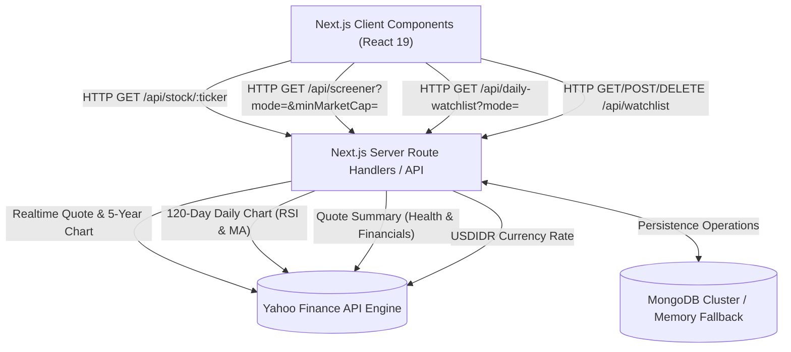

# Technical Specification Document (TSD)
## IDX Valuation & Execution Dashboard (idx-valuation-web)

**Versi:** 1.0.0  
**Tanggal:** 22 Oktober 2026  
**Status:** Approved / Production-Ready  
**Tech Stack:** Next.js 16 (App Router & Turbopack), React 19, TypeScript 5, Tailwind CSS v4, Yahoo Finance 2, MongoDB Driver

---

### 1. Arsitektur Sistem & Aliran Data



---

### 2. Struktur Repositori & File Proyek

```
idx-valuation-web/
├── docs/
│   ├── FSD.md                     # Functional Specification Document
│   └── TSD.md                     # Technical Specification Document
├── src/
│   ├── app/
│   │   ├── api/
│   │   │   ├── daily-watchlist/
│   │   │   │   └── route.ts       # Endpoint kurasi saham harian (Invest & Swing)
│   │   │   ├── screener/
│   │   │   │   └── route.ts       # Endpoint ranking MoS & Momentum Swing
│   │   │   ├── stock/[ticker]/
│   │   │   │   └── route.ts       # Detail analitik valuasi, deviasi, teknikal
│   │   │   └── watchlist/
│   │   │       └── route.ts       # CRUD watchlist pengguna (MongoDB / Memory)
│   │   ├── favicon.ico
│   │   ├── globals.css            # Tailwind CSS v4 setup
│   │   ├── layout.tsx             # Root layout & font definition
│   │   └── page.tsx               # Single-Page Interactive Dashboard UI
│   └── lib/
│       └── mongodb.ts             # MongoDB client singleton connection
├── public/                        # Aset statis & SVG
├── next.config.ts                 # Next.js 16 configuration
├── package.json                   # Dependencies & scripts
├── tsconfig.json                  # TypeScript strict configuration
└── .env.local                     # Environment variables (MONGODB_URI)
```

---

### 3. Spesifikasi Kontrak API (Endpoints)

#### 3.1. `GET /api/stock/[ticker]`
Mengambil data detail, valuasi historis 5 tahun, kalkulasi deviasi standar, rasio anti-value trap, riwayat dividen, dan radar teknikal 120 hari untuk ticker tertentu.

* **Path Parameter:**
  * `ticker` (string, required): Kode saham IDX (misal `BBRI` atau `BBRI.JK`).
* **Response Payload (JSON):**
```typescript
interface StockResponse {
  ticker: string;              // "BBRI"
  fullTicker: string;          // "BBRI.JK"
  name: string;                // "Bank Rakyat Indonesia (Persero) Tbk"
  price: number;               // 4850
  changePercent: number;       // 1.46
  marketCap: number;           // 735000000000000
  marketCapFormatted: string;  // "Rp 735.0 T"
  eps: number | null;
  bvps: number | null;
  per: {
    current: number | null;
    minus1SD: number;
    mean: number;
    plus1SD: number;
    fairPrice: number | null;
  };
  pbv: {
    current: number | null;
    minus1SD: number;
    mean: number;
    plus1SD: number;
    fairPrice: number | null;
  };
  dividend: {
    yieldPercent: number | null;
    annualRate: number | null;
    history: Array<{
      date: string;
      amount: number;
      cumDate: string | null;
      cumPrice: number | null;
      yieldOnCum: number | null;
    }>;
  };
  health: {
    roe: number | null;
    der: number | null;
    profitMargin: number | null;
    revenueGrowth: number | null;
    earningsGrowth: number | null;
    isBank: boolean;
  };
  technicals: {
    rsi: number;               // 14-period RSI
    ma20: number | null;       // 20-day Simple Moving Average
    ma50: number | null;       // 50-day Simple Moving Average
    volSpike: number;          // Today volume vs 20D average volume ratio
    resistance: number;        // 20-day high
    support: number;           // 20-day low
    trend: 'uptrend' | 'downtrend' | 'sideways';
    signal: string;            // e.g. "🟢 Oversold (Pantulan Rebound)"
    signalBadge: string;
  };
}
```

---

#### 3.2. `GET /api/screener`
Menghasilkan daftar ranking emiten yang disaring berdasarkan minimal kapitalisasi pasar dan mode operasional (*Invest* vs *Swing*).

* **Query Parameters:**
  * `mode` (string, optional): `'invest'` (default) | `'swing'`.
  * `minMarketCap` (number, optional): Nilai batas minimum kapitalisasi pasar dalam Rupiah (default `1_000_000_000_000`).
* **Logika Penyortiran:**
  * `mode === 'invest'`: Diurutkan secara menurun (*descending*) berdasarkan `marginOfSafety`.
  * `mode === 'swing'`: Diurutkan secara menurun (*descending*) berdasarkan skor gabungan:
    $$\text{Swing Score} = (\text{Upside Potential} \times 1.5) + \text{RSI Oversold Bonus} + \text{Volume Spike Bonus} + (\text{Change \%} \times 3)$$
* **Response Payload (JSON):**
```typescript
interface ScreenerResponse {
  timestamp: string;
  minMarketCap: string;
  minMarketCapRaw: number;
  count: number;
  stocks: Array<{
    ticker: string;
    name: string;
    price: number;
    changePercent: number;
    marketCap: number;
    marketCapFormatted: string;
    per: number | null;
    pbv: number | null;
    dividendYield: number | null;
    marginOfSafety: number;
    status: 'undervalued' | 'fair' | 'expensive';
    rsi: number | null;
    volSpike: number | null;
    trend: 'uptrend' | 'downtrend' | 'sideways';
    swingPotential: number;     // Jarak ke resistance terdekat (%)
    swingSignal: string;
    swingSignalBadge: string;
  }>;
}
```

---

#### 3.3. `GET /api/daily-watchlist`
Menghasilkan pilihan saham terbaik hari ini yang dikelompokkan ke dalam kategori strategis berdasarkan mode aktif.

* **Query Parameter:**
  * `mode` (string, optional): `'invest'` | `'swing'`.
* **Kategori Dinamis:**
  * **Invest:** `super-undervalued`, `high-dividend`, `rebound-momentum`, `oversold-bluechip`.
  * **Swing:** `volume-breakout`, `swing-rebound`, `momentum-runner`, `rebound-momentum`.

---

#### 3.4. `GET`, `POST`, `DELETE /api/watchlist`
Operasi CRUD daftar pantauan pengguna dengan persistensi MongoDB dan *fail-safe memory buffer*.

* **GET:** Mengembalikan array objek `{ ticker, name, addedAt, notes }` dan indikator `storage` (`'mongodb'` atau `'memory'`).
* **POST:** Menyimpan saham baru ke koleksi `watchlist` menggunakan operasi *upsert*.
* **DELETE:** Menghapus dokumen berdasarkan parameter query `?ticker=CODE`.

---

### 4. Algoritma Kunci & Komputasi Finansial

#### 4.1. Normalisasi Mata Uang Emiten Asing (USD Reporting)
Sebagian emiten di BEI (seperti ADRO, PTRO, MEDC, ITMG) melaporkan ekuitas dan laba dalam mata uang USD, sementara harga saham di bursa diperdagangkan dalam IDR. Sistem secara otomatis melakukan kurs silang (*cross-rate*) memanfaatkan ticker `USDIDR=X`:
```typescript
if (quote.financialCurrency === 'USD') {
  if (bookValue && bookValue < 50) {
    const bvpsIdr = bookValue * usdIdrRate;
    priceToBook = currentPrice / bvpsIdr;
    bookValue = bvpsIdr;
  }
}
```

#### 4.2. Perhitungan 14-Period Relative Strength Index (RSI)
Dihitung dari deret data harga penutupan (*Close*) harian selama 14 periode:
```typescript
let gains = 0;
let losses = 0;
for (let i = quotes.length - 14; i < quotes.length; i++) {
  const prev = Number(quotes[i - 1]?.close || 0);
  const curr = Number(quotes[i]?.close || 0);
  const diff = curr - prev;
  if (diff >= 0) gains += diff;
  else losses += Math.abs(diff);
}
const avgGain = gains / 14;
const avgLoss = losses / 14;
const rsi = avgLoss === 0 ? 100 : 100 - (100 / (1 + (avgGain / avgLoss)));
```

#### 4.3. Formula Matematis Average Down (Mode Target Avg)
Menentukan jumlah lembar saham tambahan ($L_1$) yang wajib dibeli pada harga pasar saat ini ($P_1$) agar rata-rata portofolio awal ($P_0, L_0$) turun menjadi $P_{\text{target}}$:
$$P_{\text{target}} = \frac{(P_0 \times L_0) + (P_1 \times L_1)}{L_0 + L_1}$$
$$\iff P_{\text{target}} \times L_0 + P_{\text{target}} \times L_1 = P_0 \times L_0 + P_1 \times L_1$$
$$\iff L_1 \times (P_{\text{target}} - P_1) = L_0 \times (P_0 - P_{\text{target}})$$
$$\iff L_1 = \left\lceil \frac{L_0 \times (P_0 - P_{\text{target}})}{P_{\text{target}} - P_1} \right\rceil$$

---

### 5. Keamanan, Penanganan Error & Kinerja

1. **Suppression Notices Yahoo Finance:**
   Pustaka `yahoo-finance2` dikonfigurasi dengan `suppressNotices: ['yahooSurvey', 'ripHistorical']` guna mencegah *overhead* *logging* di konsol server.
2. **Dynamic Route Rendering:**
   Semua *route handler* yang membaca query string (`request.url`) dideklarasikan secara dinamis (`force-dynamic`) untuk mencegah kegagalan prerendering saat tahap `next build`.
3. **Database Resiliency (Graceful Degradation):**
   Jika variabel lingkungan `MONGODB_URI` belum disediakan pada `.env.local`, modul [mongodb.ts](file:///d:/repos/misc/idx-valuation-web/src/lib/mongodb.ts) tidak akan memutus koneksi server melainkan mengaktifkan penyimpanan cadangan *in-memory array* sehingga aplikasi tetap dapat digunakan 100% tanpa konfigurasi database yang rumit.
4. **Client-Side Responsive Design:**
   Seluruh tata letak menggunakan grid Tailwind CSS adaptif (`grid-cols-12` pada layar lebar desktop, dan susunan *single-column vertical stack* pada perangkat seluler) dengan konsistensi warna ramah mata (Slate, Indigo, Emerald, Amber, Rose).
